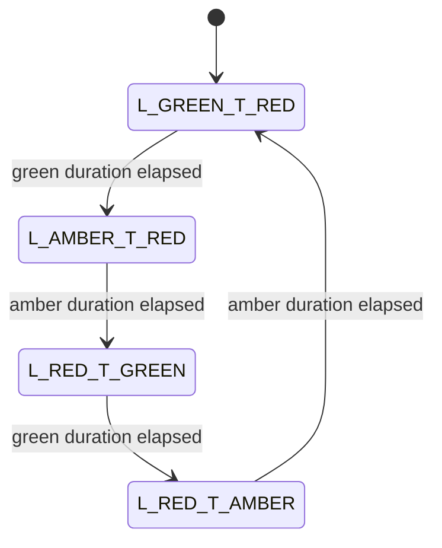

# Lab 3 report

## 5.2 Exercise 1: Sketch an FSM

The existing traffic-light sketches describe two cooperating state machines. The
operating mode starts at NORMAL (mode 1). Each debounced button-1 press advances
NORMAL -> SET_RED (2) -> SET_AMBER (3) -> SET_GREEN (4) -> NORMAL. In a setting
mode, button 2 proposes a duration and button 3 confirms it. These adjustment
behaviors are a design for later work, not implemented by exercises 1-5.

In NORMAL, the traffic cycle is:

L denotes left/right traffic; T denotes top/bottom traffic. Opposing green
lights are never on together. Red duration equals the opposing green plus amber
durations. Setting modes blink the selected color at 2 Hz and display the mode
and proposed duration. Exact duration limits must follow the full assignment;
the supplied excerpt does not specify them.

Editable sketches: [FSM](traffic-light-fsm.drawio) and
[compatible copy](traffic-light-fsm-compatible.drawio). Illustrations:
[traffic cycle](traffic-light-cycle.png), [modes](traffic-light-modes.png).

This branch contains the FSM report and reusable libraries. The old Lab 2
application has been removed; main is an idle scaffold. Lab 3 schematic wiring,
timer demonstration and button integration belong to later branches.

Validation: firmware compiled and linked with `ninja -C build/Debug`.

## 5.3 Exercise 2: Proteus schematic

The existing editable [Lab 3 project](../protues/lab3.pdsprj) is retained as the
schematic for this exercise. It contains the STM32F103C8, opposing traffic LED
groups, common-anode displays with PNP drivers, three buttons and indicator D15.
The wiring contract used for the next exercise is:

| Signal | MCU pins | Polarity |
| --- | --- | --- |
| D15 indicator | PA5 | Active low |
| Seven-segment A-G | PA8-PA14 | Active low |
| Paired digit enables | PA0, PA1 | Active low PNP |
| Left/right traffic group | PB0-PB2 | Active high |
| Top/bottom traffic group | PB3-PB5 | Active high |
| Buttons 1-3 | PB13-PB15 | Pull-up, switch to ground |

The two enable lines select pairs of digits (0/2 and 1/3); paired digits cannot
show independent values with this wiring. PA13/PA14 and PB3/PB4 require debug
port release. Use 3.3 V MCU power and a common ground. Retain the schematic's
current-limiting resistors and PNP base resistors.

Validation: the Proteus project archive opens structurally and contains ROOT.DSN
and ROOT.CDB. Firmware still builds. No Proteus simulation or electrical/net
connectivity validation was run; compare the pin table with the drawing before
hardware use. No Lab 3 GPIO or timer application is introduced on this branch.

## 5.4 Exercise 3: Create STM32 project

CO3010.ioc and src/pin.h describe the pin table above. main.c configures the
outputs off before switching their GPIO modes, configures PB13-PB15 as pull-up
inputs, and releases the debug pins. The project uses the existing HAL, GNU Arm
C11 toolchain and CMake/Ninja build.

HSI/2 times PLL multiplier 9 gives SYSCLK = 36 MHz. APB1 runs at 18 MHz, so its
timer clock is doubled to 36 MHz. TIM2 prescaler 35999 and ARR 9 give:

    T = (35999 + 1) * (9 + 1) / 36000000 = 0.010 s

HAL_TIM_Base_Start_IT starts TIM2 after GPIO initialization. TIM2_IRQHandler
calls HAL_TIM_IRQHandler, and HAL_TIM_PeriodElapsedCallback increments tick_count
only for TIM2. Observe tick_count in a debugger: it should advance by about 100
per second. No button reader, mode control or application scheduling runs yet.

Validation: ninja -C build/Debug compiles and links the firmware and emits
build/Debug/CO3010.hex. Interrupt cadence has not been measured in Proteus or on
hardware. Load this HEX in U1's Program File property when simulating.

## 5.5 Exercise 4: Modify timer parameters

Change only TICK_INTERVAL_MS in lib/software_timer/software_timer.h (1, 10 or
100). The prescaler remains 35999, producing a 1 kHz counter. A CubeMX USER CODE
block overrides ARR with TICK_INTERVAL_MS - 1 after timer initialization. The
IOC retains the default 10 ms setup; runtime configuration is authoritative.

TIM2 accumulates elapsed milliseconds and toggles PA5/D15 whenever 250 ms has
elapsed. Carrying the remainder preserves the average 500 ms full period (2 Hz).
At 1 and 10 ms, edges land exactly on 250 ms boundaries. At 100 ms, half-periods
alternate 300/200 ms. Exact uniform 250 ms edges are impossible using only 100 ms
interrupt boundaries; a finer interrupt or hardware output compare is needed.

Software timers now store milliseconds and expire on the first interrupt at or
after their deadline, including durations shorter than a tick. Zero disables a
timer. Callers do not need to convert duration arguments when the tick changes.

Validation: firmware builds at the default interval. tests/timer_selfcheck.c
checks actual timer functions for early expiry, one-shot flag consumption, short
durations, zero and invalid indices. This target self-check is compiled at 1,
10 and 100 ms separately; execution requires test firmware on STM32/Proteus and
has not been performed here. The indicator waveform also requires simulation.
