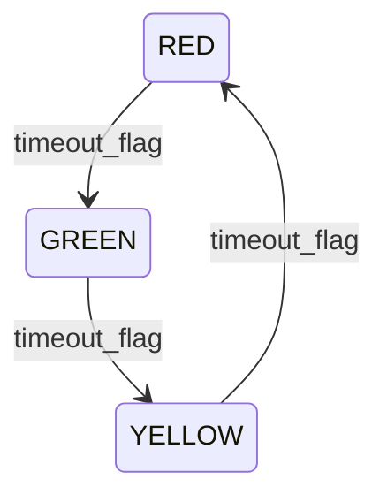

# Lab 3 report

## 5.2 Exercise 1: Sketch an FSM

The redrawn diagram separates the project operating modes from the traffic subsystem. The
operating mode starts at NORMAL (mode 1). Each debounced button-1 press advances
NORMAL -> SET_RED (2) -> SET_AMBER (3) -> SET_GREEN (4) -> NORMAL. In a setting
mode, button 2 proposes a duration and button 3 confirms it. These adjustment
behaviors are a design for later work, not implemented by exercises 1-5.

The traffic subsystem uses a separate three-state FSM for each direction:

Each direction has its own one-second software timer and countdown in seconds.
When a countdown reaches zero, its timeout flag advances that light's FSM.
Initialization/reset sets straight GREEN and cross RED with countdowns green_s
and green_s + yellow_s, clears both flags, and leaves the subsystem paused.
TRAFFIC_SYSTEM_Start explicitly starts counting. The normal-mode application
has not yet been wired to this subsystem.

L denotes left/right traffic; T denotes top/bottom traffic. Opposing green
lights are never on together. Red duration equals the opposing green plus amber
durations. Setting modes blink the selected color at 2 Hz and display the mode
and proposed duration. Exact duration limits must follow the full assignment;
the supplied excerpt does not specify them.

Editable two-page diagram: [FSM](traffic-light-fsm.drawio) and
[compatible copy](traffic-light-fsm-compatible.drawio). Illustrations:
[traffic cycle](traffic-light-cycle.png), [modes](traffic-light-modes.png).

The Exercise 1 branch contains the FSM report and reusable libraries. The old Lab 2
application was removed there; main was an idle scaffold. Lab 3 schematic wiring,
timer demonstration and button integration were added incrementally in later branches.

Validation: firmware compiled and linked with `ninja -C build/Debug`.

## 5.3 Exercise 2: Proteus schematic

The existing editable [Lab 3 project](../protues/lab3.pdsprj) is retained as the
schematic for this exercise. It contains the STM32F103C8, opposing traffic LED
groups, common-anode displays with PNP drivers, three buttons and indicator D15.
The wiring contract used for the next exercise is:

### STM32F103C8 (U1) MCU pinout and net connections

Pin numbers refer to the LQFP48 package.

| Pin name | Pin # | Connected net / function | Description / target peripheral |
| --- | --- | --- | --- |
| PA5 | 15 | Active-low LED | D15 red LED cathode; anode connects to +3V3 |
| PA8 | 29 | SEG0 | Seven-segment A |
| PA9 | 30 | SEG1 | Seven-segment B |
| PA10 | 31 | SEG2 | Seven-segment C |
| PA11 | 32 | SEG3 | Seven-segment D |
| PA12 | 33 | SEG4 | Seven-segment E |
| PA13 | 34 | SEG5 | Seven-segment F |
| PA14 | 37 | SEG6 | Seven-segment G |
| PB0 | 18 | L0 | Left/right LED indicators through 220 Ω resistors R10 and R4 |
| PB1 | 19 | L1 | Left/right LED indicators through 220 Ω resistors R11 and R5 |
| PB2 | 20 | L2 | Left/right LED indicators through 220 Ω resistors R12 and R6 |
| PB3 | 39 | T0 | Top/bottom LED indicators through 220 Ω resistors R1 and R7 |
| PB4 | 40 | T1 | Top/bottom LED indicators through 220 Ω resistors R2 and R8 |
| PB5 | 41 | T2 | Top/bottom LED indicators through 220 Ω resistors R3 and R9 |
| PB13 | 26 | BTN0 | Pushbutton 1, normally open switch to GND |
| PB14 | 27 | BTN1 | Pushbutton 2, normally open switch to GND |
| PB15 | 28 | BTN2 | Pushbutton 3, normally open switch to GND |

### Peripheral breakdown

**A. Seven-segment displays (common anode)**

SEG0 through SEG6 connect to inputs A through G on both dual-digit display
modules. Segments are active low. PNP transistors supply the digit anodes;
their emitters connect to +3V3 and their enables are active low.

| Enable | Firmware MCU pin | PNP driver | Digit | Base resistor |
| --- | --- | --- | --- | --- |
| EN0 | PA0 (pin 10) | Q3 | DIGIT0 | R39, 1 kΩ |
| EN0 | PA0 (pin 10) | Q1 | DIGIT2 | R13, 1 kΩ |
| EN1 | PA1 (pin 11) | Q4 | DIGIT1 | R40, 1 kΩ |
| EN1 | PA1 (pin 11) | Q2 | DIGIT3 | R14, 1 kΩ |

PA0/PA1 are the firmware's chosen enable assignments; the supplied connection
list identifies EN0/EN1 without specifying their MCU pins.

**B. Circular LED indicators (discrete LEDs)**

Each traffic output drives two LED branches through separate 220 Ω resistors
to GND. These outputs are active high.

| Group | Output 0 / resistor | Output 1 / resistor | Output 2 / resistor |
| --- | --- | --- | --- |
| Top | T0 / R1 | T1 / R2 | T2 / R3 |
| Bottom | T0 / R7 | T1 / R8 | T2 / R9 |
| Left | L0 / R10 | L1 / R11 | L2 / R12 |
| Right | L0 / R4 | L1 / R5 | L2 / R6 |

For both L and T, index 0 = green, 1 = yellow, and 2 = red.
Firmware uses this confirmed color order.

**C. Pushbuttons**

| Button | Connection |
| --- | --- |
| 1 | BTN0 (PB13) → normally open tactile switch → GND |
| 2 | BTN1 (PB14) → normally open tactile switch → GND |
| 3 | BTN2 (PB15) → normally open tactile switch → GND |

Enable the internal pull-ups in firmware. Released buttons read high; pressed
buttons read low.

The two enable lines select pairs of digits (0/2 and 1/3); paired digits cannot
show independent values with this wiring. PA13/PA14 and PB3/PB4 require debug
port release. Use 3.3 V MCU power and a common ground. Retain the schematic's
current-limiting resistors and PNP base resistors.

Validation: the Proteus project archive opens structurally and contains ROOT.DSN
and ROOT.CDB. Firmware still builds. No Proteus simulation or electrical/net
connectivity validation was run; compare the pin table with the drawing before
hardware use. No Lab 3 GPIO or timer application is introduced on this branch.

## 5.4 Exercise 3: Create STM32 project

CO3010.ioc and src/pin.h describe the pin table above. main.c configures the
outputs off before switching their GPIO modes, configures PB13-PB15 as pull-up
inputs, and releases the debug pins. The project uses the existing HAL, GNU Arm
C11 toolchain and CMake/Ninja build.

HSI/2 times PLL multiplier 9 gives SYSCLK = 36 MHz. APB1 runs at 18 MHz, so its
timer clock is doubled to 36 MHz. TIM2 prescaler 35999 and ARR 9 give:

    T = (35999 + 1) * (9 + 1) / 36000000 = 0.010 s

HAL_TIM_Base_Start_IT starts TIM2 after GPIO initialization. TIM2_IRQHandler
calls HAL_TIM_IRQHandler, and HAL_TIM_PeriodElapsedCallback increments tick_count
only for TIM2. Observe tick_count in a debugger: it should advance by about 100
per second. No button reader, mode control or application scheduling runs yet.

Validation: ninja -C build/Debug compiles and links the firmware and emits
build/Debug/CO3010.hex. Interrupt cadence has not been measured in Proteus or on
hardware. Load this HEX in U1's Program File property when simulating.

## 5.5 Exercise 4: Modify timer parameters

Change only TICK_INTERVAL_MS in lib/software_timer/software_timer.h (1, 10 or
100). The prescaler remains 35999, producing a 1 kHz counter. A CubeMX USER CODE
block overrides ARR with TICK_INTERVAL_MS - 1 after timer initialization. The
IOC retains the default 10 ms setup; runtime configuration is authoritative.

TIM2 accumulates elapsed milliseconds and toggles PA5/D15 whenever 250 ms has
elapsed. Carrying the remainder preserves the average 500 ms full period (2 Hz).
At 1 and 10 ms, edges land exactly on 250 ms boundaries. At 100 ms, half-periods
alternate 300/200 ms. Exact uniform 250 ms edges are impossible using only 100 ms
interrupt boundaries; a finer interrupt or hardware output compare is needed.

Software timers accept milliseconds, store rounded-up tick counts and expire on the first interrupt at or
after their deadline, including durations shorter than a tick. Zero disables a
timer. Callers do not need to convert duration arguments when the tick changes.

Validation: firmware builds at the default interval. tests/timer_selfcheck.c
checks actual timer functions for early expiry, one-shot flag consumption, short
durations, zero and invalid indices. This target self-check is compiled at 1,
10 and 100 ms separately; execution requires test firmware on STM32/Proteus and
has not been performed here. The indicator waveform also requires simulation.

## 5.6 Exercise 5: Button debouncing and mode selection

New input_reading.c/.h and output_display.c/.h files separate input sampling and
display output. The reusable button library accepts a press or release only
after three identical samples. INPUT_ModePressed polls using HAL_GetTick every
10 ms, independently of TIM2; a stable transition takes approximately 20-30 ms.
The main loop must remain nonblocking to preserve this sampling cadence.

Button 1 (PB13, active low) generates one event per press. Auto-repeat is disabled
so holding the button does not advance modes repeatedly. Both scanning and event
consumption run in the main loop, avoiding interrupt/main flag races. Each event
advances the project FSM in lib/fsm through: NORMAL (1), RED setting (2), AMBER setting (3), GREEN
setting (4), then NORMAL. main.c delegates mode transitions to FSM_Run and displays
the selected mode. Buttons 2/3 and the full traffic FSM are deferred to
later exercises; this exercise implements mode selection only.

OUTPUT_ShowMode blanks both enables before changing segments, then enables the
first pair. Digits 0 and 2 show the same mode, while digits 1 and 3 stay blank,
matching the shared-enable limitation. D15 continues the exercise-4 blink.

Validation: firmware compiles and links. tests/button_selfcheck.c covers bouncing,
press flag consumption, holding without repeats, debounced release and repress.
The standalone test is cross-compiled, with a fake GPIO reader; it is not linked
into normal firmware and was not executed on a target. Manual Proteus checks:
press button 1 repeatedly to observe 1 -> 2 -> 3 -> 4 -> 1, hold for one second
(no further advance), then release and repress. Recheck the D15 blink at TIM2
intervals 1, 10 and 100 ms. Simulation has not been run in this environment.

## Incremental branch layout

l03/ex1 -> l03/ex2 -> l03/ex3 -> l03/ex4 -> l03/ex5. Each branch includes the
preceding reports and implementation only. Universal libraries can be present
before use. The untouched pre-split working tree is preserved in
backup/l03-before-exercise-split, including Proteus backups/workspace files.
