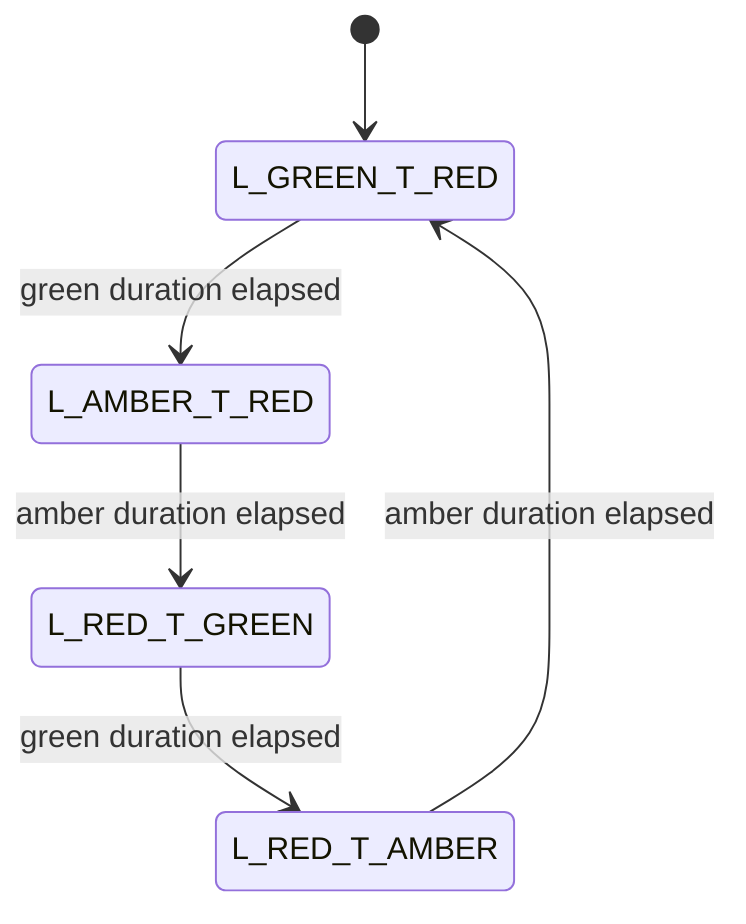

# Lab 3 report

## 5.2 Exercise 1: Sketch an FSM

The existing traffic-light sketches describe two cooperating state machines. The
operating mode starts at NORMAL (mode 1). Each debounced button-1 press advances
NORMAL -> SET_RED (2) -> SET_AMBER (3) -> SET_GREEN (4) -> NORMAL. In a setting
mode, button 2 proposes a duration and button 3 confirms it. These adjustment
behaviors are a design for later work, not implemented by exercises 1-5.

In NORMAL, the traffic cycle is:

L denotes left/right traffic; T denotes top/bottom traffic. Opposing green
lights are never on together. Red duration equals the opposing green plus amber
durations. Setting modes blink the selected color at 2 Hz and display the mode
and proposed duration. Exact duration limits must follow the full assignment;
the supplied excerpt does not specify them.

Editable sketches: [FSM](traffic-light-fsm.drawio) and
[compatible copy](traffic-light-fsm-compatible.drawio). Illustrations:
[traffic cycle](traffic-light-cycle.png), [modes](traffic-light-modes.png).

This branch contains the FSM report and reusable libraries. The old Lab 2
application has been removed; main is an idle scaffold. Lab 3 schematic wiring,
timer demonstration and button integration belong to later branches.

Validation: firmware compiled and linked with `ninja -C build/Debug`.